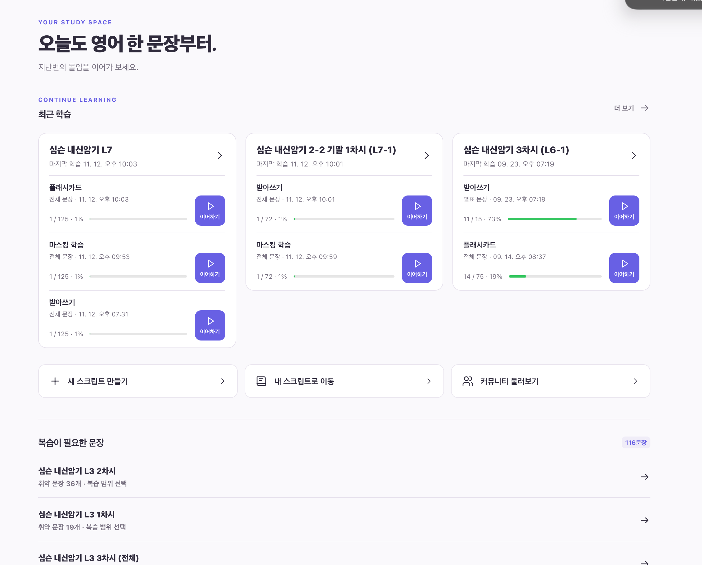
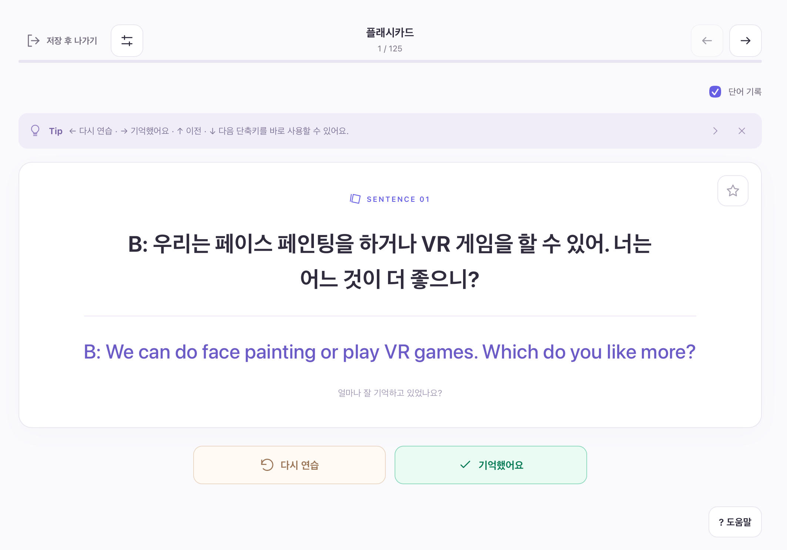
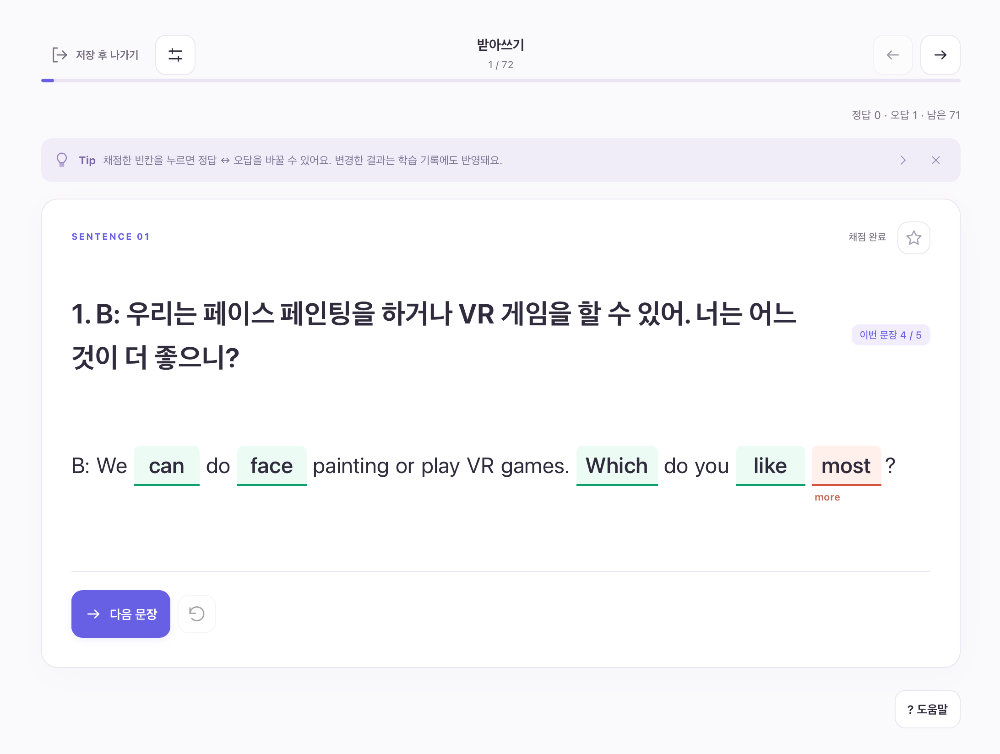
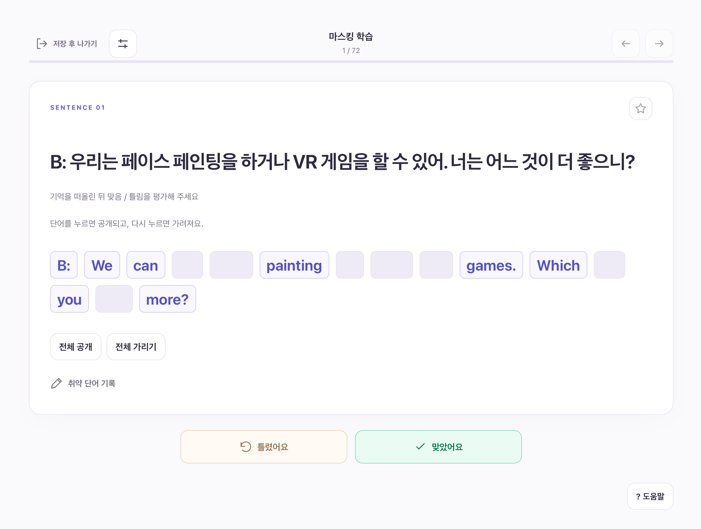
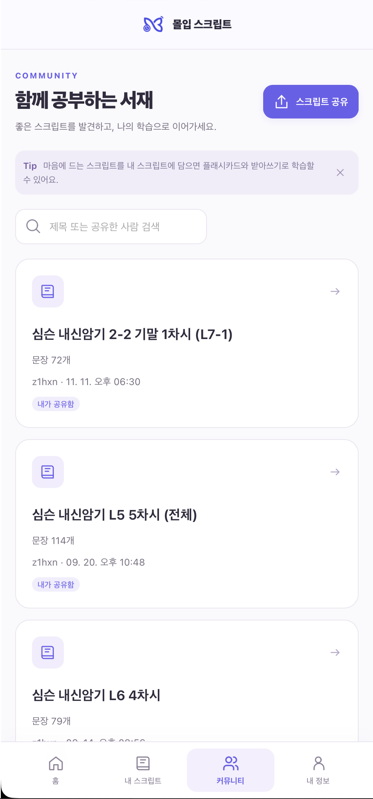

  

<h1 align="center">몰입 스크립트</h1>

  영어 본문을 문장별로 나누어 플래시카드, 받아쓰기, 마스킹으로 암기하는 학습 서비스입니다.

## 어떤 서비스인가요?

암기할 영어 본문을 스크립트로 만들고 세 가지 방법으로 반복 학습할 수 있습니다. 어려운 단어와 문장을 기록하고, 저장한 위치에서 다시 이어갈 수 있습니다.

- **플래시카드**: 한글 뜻을 보고 영어를 떠올린 뒤, 기억 여부를 평가합니다.
- **받아쓰기**: 영어 문장의 빈칸을 채우고 채점합니다. 결과를 수정하거나 틀린 문제만 다시 풀 수 있습니다.
- **마스킹 학습**: 가려진 단어를 하나씩 공개하거나 다시 가리며 연습합니다. 맞음·틀림 평가와 취약 단어 기록을 지원합니다.
- **학습 관리**: 학습 범위를 선택하고 취약 문장·단어와 별표를 모아 복습합니다.
- **커뮤니티**: 공개 스크립트를 검색하고 내 스크립트에 담을 수 있습니다. 좋아요, 댓글, 게시자 팔로우도 지원합니다.
- **비회원 체험**: 가입 없이 전용 스크립트로 세 가지 학습을 체험할 수 있습니다. 체험 기록은 저장되지 않습니다.

## 실제 서비스 화면

아래 사진은 실제 서비스 사용 화면입니다. 사진 속 스크립트와 학습 수치는 촬영 당시의 예시입니다.

### 학습 대시보드

홈에서 진행 중인 학습을 모드별로 이어가고, 복습이 필요한 문장을 확인할 수 있습니다. 홈은 최근 학습 최대 3개를 표시하며 더 보기에서 전체 목록을 확인합니다.

### 세 가지 학습 방법

사진을 누르면 원본 크기로 볼 수 있습니다.

| 플래시카드 | 받아쓰기 | 마스킹 학습 |
| --- | --- | --- |
|  |  |  |
| 뜻을 보고 문장을 회상한 뒤 기억 여부를 평가합니다. | 빈칸을 채우고 정답과 오답을 확인합니다. | 필요한 단어만 공개하며 문장을 연습합니다. |

### 모바일 커뮤니티

휴대폰에서도 공개 스크립트를 검색하고 살펴볼 수 있습니다. PC에서는 목록형과 카드형 중 원하는 보기를 선택할 수 있습니다.

## 시작하는 방법

1. 로그인 없이 체험용 스크립트로 학습 방법을 살펴봅니다.
2. 내 자료를 학습하려면 가입하거나 로그인합니다.
3. 내 스크립트에서 영어 본문을 추가하거나 커뮤니티의 공개 자료를 담습니다.
4. 플래시카드·받아쓰기·마스킹 중 학습 방법과 범위를 선택합니다.
5. 저장된 학습을 이어가거나 취약 문장을 다시 연습합니다.

PC와 모바일을 지원하며, 홈 화면에 추가해 앱처럼 실행할 수 있습니다.

## 만든 사람

Created by [@z1hxn](https://github.com/z1hxn) · [Molip Script](https://github.com/molipstudy/Molip-Script)
